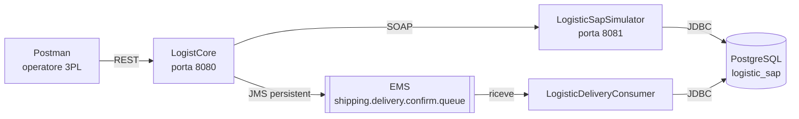

# Logistics & SAP Enterprise Integration

Esercizio finale del corso TIBCO BusinessWorks 6 (Key Partner). Un operatore logistico (3PL) prende in carico documenti SAP con una `GET` e conferma le consegne con una `POST`; un simulatore SAP espone SOAP su un database PostgreSQL, e la conferma passa da una coda EMS a un consumer che aggiorna il database.

## Architettura



**Fase 1, la GET:** Postman → `LogistCore` → il simulatore SAP legge e aggiorna `sap_orders` → `LogistCore` risponde con i documenti presi in carico.

**Fase 2, la POST:** Postman → `LogistCore` → il simulatore SAP controlla codice e stato → `LogistCore` mette il messaggio in coda e risponde **202** → il consumer prende il messaggio e aggiorna il database.

## Prerequisiti

- TIBCO BusinessWorks 6.9 con le librerie client di EMS installate (`bwinstall ems-driver`).
- TIBCO EMS 8.4 e PostgreSQL in locale.

### 1. Database

In PostgreSQL creare il database `logistic_sap` ed eseguire:

```sql
-- Ordini SAP
CREATE TABLE sap_orders (
    document_id VARCHAR(50) PRIMARY KEY,
    carrier_id VARCHAR(50),
    status VARCHAR(20), -- 'DA GESTIRE', 'GESTITO', 'CONSEGNATO'
    destination VARCHAR(100)
);

-- Trascodifica dei codici esterni
CREATE TABLE order_mapping (
    external_code VARCHAR(50) PRIMARY KEY,
    sap_order_id VARCHAR(50)
);

-- Storico consegne
CREATE TABLE delivery_history (
    sap_order_id VARCHAR(50) PRIMARY KEY,
    delivery_date TIMESTAMP,
    notes VARCHAR(255)
);

-- Dati di test
INSERT INTO sap_orders VALUES ('DOC-2026-001', 'DHL001', 'DA GESTIRE', 'Milano');
INSERT INTO sap_orders VALUES ('DOC-2026-002', 'DHL001', 'GESTITO', 'Roma');
INSERT INTO sap_orders VALUES ('DOC-2026-003', 'DHL001', 'DA GESTIRE', 'Torino');
INSERT INTO order_mapping VALUES ('EXT-998877', 'DOC-2026-001');
```

La connessione usa le Module Properties `db.url` (`jdbc:postgresql://localhost:5432/logistic_sap?prepareThreshold=0`), `db.username` e `db.password` dello shared module `LogisticSapConnection`.

### 2. EMS e coda

Avviare il server (la finestra resta aperta):
```
<EMS_HOME>\ems\8.4\bin\tibemsd.exe -config <cartella di configurazione>\tibemsd.conf
```
Creare la coda una volta sola:
```
<EMS_HOME>\ems\8.4\bin\tibemsadmin.exe -server tcp://localhost:7222 -user admin
create queue shipping.delivery.confirm.queue
```
La password di `admin` è vuota. La connessione usa le Module Properties `ems.url` (`tcp://localhost:7222`) ed `ems.username`.

## Avvio

**Da Business Studio:** *Run Configurations* con le tre applicazioni.

**Deploy su AppSpace locale** (bwagent in enterprise mode, database + EMS). Gli `.ear` si generano da Studio (*Package Unit → Overview → Export Application for Deployment*) o si scaricano dalla release `v1.0`. Con `bwadmin` i percorsi vanno scritti con `/`:
```
bwadmin create domain LogisticDomain
bwadmin create -d LogisticDomain appspace LogisticAppSpace
bwadmin create -d LogisticDomain -a LogisticAppSpace -httpPort 8095 appnode LogisticAppNode
bwadmin start -d LogisticDomain appspace LogisticAppSpace
bwadmin upload -d LogisticDomain C:/percorso/LogisticSapSimulator.application_1.0.0.ear
bwadmin deploy -d LogisticDomain -a LogisticAppSpace LogisticSapSimulator.application_1.0.0.ear
bwadmin start -d LogisticDomain -a LogisticAppSpace application LogisticSapSimulator.application 1.0
```
(stessi `upload`, `deploy` e `start` per `LogistCore` e `LogisticDeliveryConsumer`). I log sono in `domains/LogisticDomain/appnodes/LogisticAppSpace/LogisticAppNode/log/bwappnode.log`.

## API

**`GET /documents?carrierId=DHL001`**: prende in carico (porta a `GESTITO`) i documenti del corriere che sono `DA GESTIRE` e restituisce solo quelli.

**`POST /deliveries`**: conferma una consegna; controlla in SAP codice esterno e stato, mette il messaggio in coda e risponde subito.
```json
{ "externalOrderCode": "EXT-998877", "deliveryDate": "2026-05-15T14:30:00Z", "notes": "Consegnato al portiere" }
```

| Codice | GET | POST | Body |
|---|---|---|---|
| 200 | documenti presi in carico (anche nessuno) | — | `{"documents": [...]}` |
| 202 | — | consegna presa in carico | `{"message": "Presa in carico della consegna effettuata"}` |
| 400 | `CARRIER_ID_REQUIRED` | `DELIVERY_DATA_REQUIRED` | `{"code", "message"}` |
| 404 | `CARRIER_NOT_FOUND` (SAP non ha documenti) | `ORDER_NOT_FOUND` (codice esterno sconosciuto) | `{"code", "message"}` |
| 409 | — | `INVALID_ORDER_STATUS` (ordine non `GESTITO`) | `{"code", "message"}` |
| 500 | `INTERNAL_ERROR` | `INTERNAL_ERROR` | `{"code", "message"}`, dettaglio solo nel log |

Gli errori previsti sono lanciati con un **Throw** (fault `ErrorResponse`) e gestiti da un unico **Catch** per processo, che scrive il log e sceglie il codice; tutto il resto va nel **Catch All** (500).

## Scelte

- **`GetDocumentDetails` accetta `carrierId` oppure `documentId`.** Cerca per corriere oppure per documento: la GET chiede i documenti di un corriere, la POST chiede lo stato di un singolo documento.
- **202 invece di 201**: la POST non crea la risorsa subito, la mette in coda (lo chiede la traccia).
- **Messaggio EMS**: JSON (`sapOrderId`, `deliveryDate`, `notes`), *Delivery Mode* **Persistent**: se il consumer è spento il messaggio resta in coda e viene elaborato alla riaccensione.
- **Externalization**: indirizzi, porte, credenziali e nome della coda sono Module Properties (`default.substvar`): `db.url`, `db.username`, `db.password`, `ems.url`, `ems.username`, `sap.host`, `sap.port`, `http.port`, `ems.queue.delivery`.

## Test

- Collection Postman in `postman/` (cartelle F1 = GET, F2 = POST); progetto SoapUI del simulatore in `soapui/`.
- Prima di ogni giro, riportare il database allo stato iniziale:
  ```sql
  UPDATE sap_orders SET status = 'DA GESTIRE' WHERE document_id IN ('DOC-2026-001', 'DOC-2026-003');
  UPDATE sap_orders SET status = 'GESTITO'    WHERE document_id = 'DOC-2026-002';
  DELETE FROM delivery_history;
  ```
- Il Collection Runner va lanciato con il database appena resettato e **senza F1-4**: F1-4 (500 `INTERNAL_ERROR`) si prova a mano, con il simulatore SAP spento.
